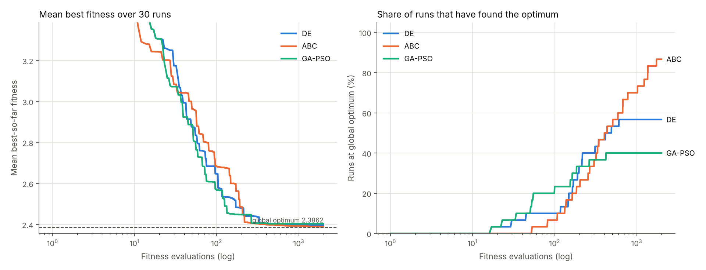
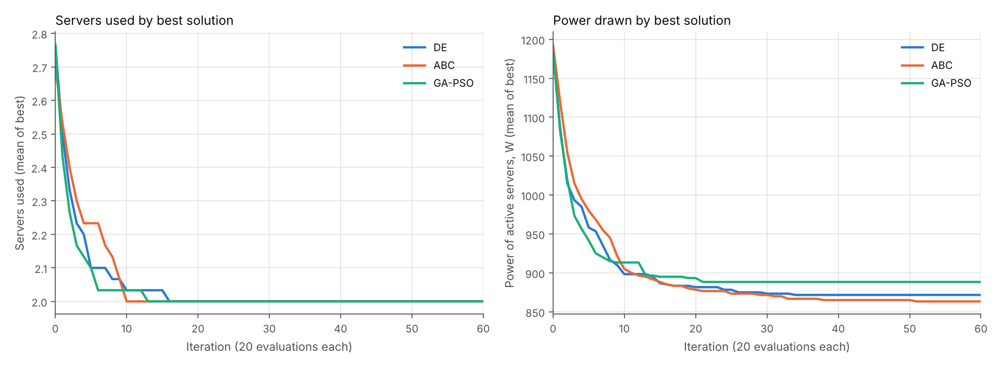

# Q9 – VM placement with DE, ABC and GA-PSO

Five virtual machines (VMs) have to be placed on five physical machines (PMs) so that
**as few servers as possible are switched on**, without going over any server's CPU,
RAM or bandwidth limit. Power draw breaks ties. Three metaheuristics solve it and are
compared:

| Algorithm | File | Idea |
|---|---|---|
| Differential Evolution (DE/rand/1/bin) | `vm_placement/de.py` | mutant = x_r1 + F·(x_r2 − x_r3), binomial crossover, greedy selection |
| Artificial Bee Colony (ABC) | `vm_placement/bee_colony.py` | employed → onlooker (roulette) → scout bees; sources that stop improving for `limit` trials are dropped |
| Hybrid GA-PSO | `vm_placement/ga_pso.py` | particles move like PSO (inertia 0.9 → 0.4), then get GA crossover with a tournament-picked personal best and random-reset mutation |

## Quick start (demo)

```bash
pip install -r requirements.txt
python main.py                 # 30 runs per algorithm, 2000 evaluations each
python -m pytest -q            # 7 tests
```

`main.py` prints the whole demo to the terminal and writes everything to `results/`:

| File | What it is |
|---|---|
| `results/report.pdf` | **The printout to hand in**: problem data and model, comparison tables, best placements, both convergence graphs |
| `results/output.txt` | The console output of the demo run |
| `results/report.md` | The same report as Markdown (renders on GitHub) |
| `results/summary.csv` | Every metric for every algorithm |
| `results/convergence.png` | Mean best fitness and % of runs at the optimum vs. fitness evaluations |
| `results/convergence_iterations.png` | Servers used and power of the best solution vs. iteration |

Options: `--runs`, `--evals`, `--pop`, `--seed`, `--out`. Runs are seeded, so results
repeat exactly (run times aside).

## Problem data

> **Check this against your question sheet.** Only PM4 (8 cores, 16 GB, 5 Gbps, 250 W) and
> VM3 (8 cores, 16 GB, 2 Gbps) were in the brief; the other values below are placeholders.
> Edit `vm_placement/data.py` and re-run `python main.py`. Nothing else needs changing.

| PM | CPU (cores) | RAM (GB) | BW (Gbps) | Power (W) |
|---|---|---|---|---|
| PM1 | 16 | 32 | 10 | 400 |
| PM2 | 32 | 64 | 20 | 600 |
| PM3 | 24 | 48 | 10 | 500 |
| PM4 | 8 | 16 | 5 | 250 |
| PM5 | 16 | 64 | 10 | 450 |

| VM | CPU (cores) | RAM (GB) | BW (Gbps) |
|---|---|---|---|
| VM1 | 4 | 8 | 1 |
| VM2 | 8 | 12 | 2 |
| VM3 | 8 | 16 | 2 |
| VM4 | 2 | 4 | 1 |
| VM5 | 12 | 16 | 3 |

## Model

**Encoding.** A solution is a list giving the PM each VM goes to (1-based):
`[3, 3, 5, 3, 1]` puts VM1, VM2 and VM4 on PM3, VM3 on PM5 and VM5 on PM1.
All three algorithms search the continuous box `[0, 5)^5`, and `decode` maps each
coordinate to `PM = floor(x) + 1`. That lets DE's difference vectors, ABC's
neighbour steps and PSO velocities work unchanged on a discrete problem.

**Fitness (minimised)**, in `vm_placement/problem.py`:

```
f = servers_used
  + power_of_active_PMs / (total_power + 1)          # tie-breaker, always < 1
  + 100 × (n_violations + Σ relative overload)        # CPU / RAM / BW limits
```

The power term is always below 1, so it can never outweigh one server. Any capacity
violation costs at least 100, more than the worst feasible fitness (< 6), so every
feasible placement beats every infeasible one. The overload part is graded, so the
algorithms are pulled towards feasibility instead of facing a flat penalty.

**Fair comparison.** Every algorithm gets the same population size (20) and the same
budget of **fitness evaluations** (2000) per run, over 30 seeded runs. The search space
is only 5^5 = 3125 placements, so `Problem.brute_force()` finds the true optimum and
every run is scored against it.

## Results (default data, 30 runs, 2000 evaluations)

Global optimum (exhaustive search): **2 servers, 850 W**, PM2 + PM4, e.g. `[2, 2, 2, 4, 2]`.

| Algorithm | Best servers | Mean servers | Best power (W) | Mean power (W) | Mean util. of best (%) | Runs at optimum | Evals to optimum* | Iters to optimum* | Run time (ms) |
|---|---|---|---|---|---|---|---|---|---|
| DE | 2 | 2.0 | 850 | 871.7 | 54.8 | 56.7 % | 225 | 11.7 | ~170 |
| ABC | 2 | 2.0 | 850 | 856.7 | 48.5 | **86.7 %** | 526 | 26.8 | ~190 |
| GA-PSO | 2 | 2.0 | 850 | 888.3 | 54.8 | 40.0 % | **127** | **6.8** | **~150** |

\* mean over the runs that reached the optimum. Utilisation is CPU/RAM/BW averaged
over the active servers of each algorithm's best placement; CPU on PM2 runs at 94–100 %.




**Discussion.**
- All three algorithms reach the minimum of **2 servers in every run**, usually within
  10–16 iterations. They differ in the tie-breaker: which pair of servers they pick.
- **GA-PSO converges fastest** (about 7 iterations when it succeeds) and has the lowest
  run time, but the pull towards `gbest` makes it settle early. It gets stuck on PM1+PM3
  (900 W) or PM3+PM5 (950 W) in 60 % of runs.
- **DE** sits in between. Once the population clusters, the difference vectors shrink
  below one PM "cell" and the search stalls at 900 W in 43 % of runs.
- **ABC** is the slowest to converge but the most reliable (87 % at 850 W). Scout bees
  restart stagnant food sources, so it keeps exploring after the others have stopped.
- Getting from 900 W (PM1+PM3) to 850 W (PM2+PM4) means moving several VMs at once,
  which is why it is a local optimum for every method.

## Layout

```
main.py                     demo entry point
vm_placement/
  data.py                   PM / VM tables (edit me)
  problem.py                encoding, decode, fitness, utilisation, brute force
  de.py  bee_colony.py  ga_pso.py
  base.py                   shared Result type and helpers
  experiment.py             repeated runs, tables, graphs, report.md / report.pdf
tests/test_vm_placement.py
results/                    generated output (committed so the printout is ready)
```
